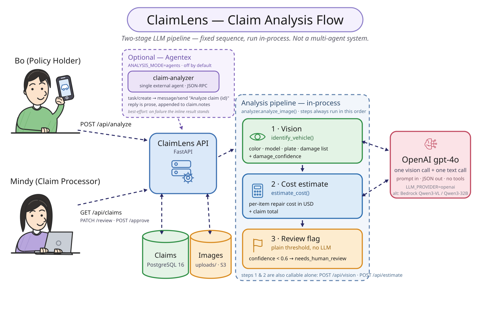
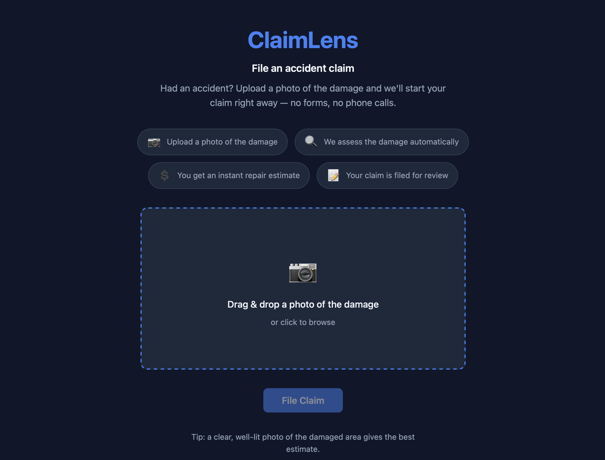
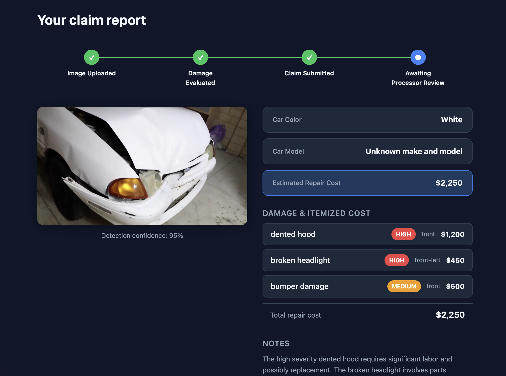
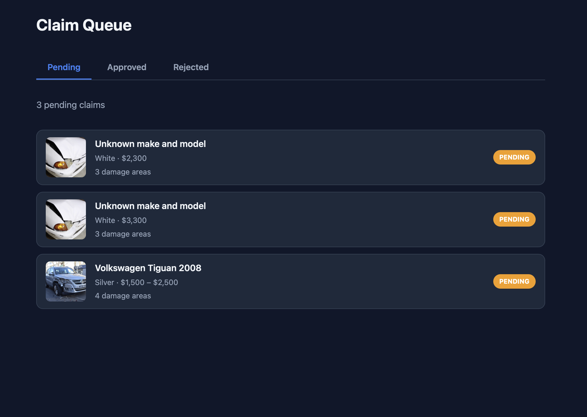

# ClaimLens

AI-assisted car-insurance claim processing. A customer uploads a photo of the
damage; ClaimLens identifies the vehicle and every visible damage area, prices
an itemized repair estimate, and files the claim. Every claim is reviewed by a
human processor, who reviews, edits, and approves line items; low-confidence
results are flagged so the processor knows to look closer.

> From a week of back-and-forth to an estimate in seconds, with a human in the loop.

## Try the demo

Running live on AWS. There are two portals, start with the owner flow, then
switch to the processor view to review what you filed.

| | Portal | What to do |
|---|---|---|
| 🚗 | **[Owner — file a claim](http://claimlens-alb-192713703.us-east-1.elb.amazonaws.com/owner)** | Upload a photo of a damaged car and get an itemized estimate in seconds |
| 🧾 | **[Processor — review queue](http://claimlens-alb-192713703.us-east-1.elb.amazonaws.com/processor)** | See pending claims, then approve, edit, or decline individual line items |

No sign-up required. Any photo of a damaged car works, or grab one of the
[sample images](backend/tests/fixtures/images) from this repo.

> **Demo, not production.** It's HTTP-only with no authentication, so please
> don't upload anything sensitive. Each upload makes real `gpt-4o` calls.
> See [Gaps and risks](docs/DEPLOYMENT.md#gaps-and-risks).



---

## Table of contents

- [Try the demo](#try-the-demo)
- [Setup instructions](#setup-instructions)
- [Architecture overview](#architecture-overview)
- [Why these tools](#why-these-tools)
- [Screens](#screens)
- [Deployment](#deployment)
- [What's next](#whats-next)
- [Evaluation](#evaluation)
- [Model evaluation](#model-evaluation)
- [Evaluation of damage detection and cost estimation](#evaluation-of-damage-detection-and-cost-estimation)

---

## Setup instructions

### Prerequisites

- Docker and Docker Compose (the quickest path), **or** Python 3.11+, Node 18+,
  and PostgreSQL 16 for a manual setup.
- An OpenAI API key with access to `gpt-4o`.

### Option A — Docker Compose (recommended)

This brings up Postgres, the FastAPI backend, and the React frontend together.

```bash
# 1. Clone and enter the repo
git clone https://github.com/fa235/claimlens.git
cd claimlens

# 2. Create the backend env file and add your OpenAI key
cp backend/.env.example backend/.env
#   then edit backend/.env and set OPENAI_API_KEY=sk-...

# 3. Start everything
docker compose up --build
```

- Frontend: http://localhost:5173
- API + docs: http://localhost:8000/docs
- Health check: http://localhost:8000/health

### Option B — Run services manually

**Backend**

```bash
cd backend
python -m venv .venv && source .venv/bin/activate
pip install -r requirements.txt

cp .env.example .env            # set OPENAI_API_KEY and DATABASE_URL
alembic upgrade head            # create tables (or let the app auto-create on first run)

uvicorn app.main:app --reload --port 8000
```

**Frontend**

```bash
cd frontend
npm install
npm run dev                     # serves on http://localhost:5173
```

### Configuration

All backend config is read from environment variables (see
[`backend/.env.example`](backend/.env.example)). The ones you'll usually touch:

| Variable | Purpose | Default |
|---|---|---|
| `OPENAI_API_KEY` | Key used for both vision and cost calls | _(required)_ |
| `LLM_PROVIDER` | `openai` (GPT-4o) or `bedrock` (Qwen, future) | `openai` |
| `OPENAI_VISION_MODEL` / `OPENAI_COST_MODEL` | Models for each step | `gpt-4o` |
| `VISION_LLM_PROVIDER` / `COST_LLM_PROVIDER` | Per-step provider override: `auto`, `openai`, `bedrock`, `fireworks` | `auto` |
| `STORAGE_BACKEND` | `local` (uploads/ folder) or `s3` | `local` |
| `DATABASE_URL` | PostgreSQL connection string | local Postgres |
| `REVIEW_CONFIDENCE_THRESHOLD` | Below this, a claim is flagged for human review | `0.6` |

Secrets live only in `backend/.env`, which is git-ignored.

### Running on open weights via Fireworks AI

Each step picks its provider independently, so you can move either one (or
both) off GPT-4o. Fireworks serves an OpenAI-compatible API, so this needs no
extra Python dependency — only a key from
[Fireworks](https://app.fireworks.ai/settings/users/api-keys).

```bash
# backend/.env — damage detection on Qwen 3.8 Max, pricing on GPT-OSS
VISION_LLM_PROVIDER=fireworks
COST_LLM_PROVIDER=fireworks
FIREWORKS_API_KEY=fw-...
```

- **Give reasoning models room.** They spend output tokens thinking before
  answering, so the vision budget is 8192 for Qwen and 4096 for Kimi rather
  than the 500 GPT-4o needs. The defaults in
  [`.env.example`](backend/.env.example) are already set correctly.
- **Expect higher vision latency.** ~6s on Kimi and ~30–50s on Qwen, against
  GPT-4o's ~3s. Kimi is the better pick when latency matters.
- **Keep images under 10MB base64.** Larger uploads are caught locally before
  the request is sent.

## Architecture overview

ClaimLens is a three-tier application: a React single-page app, a FastAPI
service, and a PostgreSQL database, with object storage for images and OpenAI
GPT-4o as the analysis engine.

### Components

| Layer | Technology | Responsibility |
|---|---|---|
| Frontend | React + Vite | Owner upload flow + processor review queue |
| API | FastAPI (Python) | Claim lifecycle, analysis orchestration, persistence |
| Analysis | OpenAI GPT-4o (swappable: Bedrock, Fireworks open weights) | One vision call (vehicle + damage), one cost call (pricing) |
| Database | PostgreSQL + SQLAlchemy / Alembic | Claims, damage line items, review state |
| Storage | Local filesystem or AWS S3 | Uploaded claim images |
| Packaging | Docker / Docker Compose | Local dev; same images run on AWS ECS Fargate |

### How data flows through it

1. **Upload.** The owner drops a photo into the React app, which `POST`s the
   image to the FastAPI backend.
2. **Persist the image.** The backend stores the file via the storage backend
   (local `uploads/` in dev, S3 in production) and creates a claim record.
3. **Vision call.** `analyze_image` sends the image to GPT-4o, which returns the
   vehicle color/model and a structured list of damage items (type, severity,
   location) plus an overall confidence.
4. **Cost call.** Each damage item is priced by a second GPT-4o call into an
   itemized repair estimate; the claim total excludes declined items.
5. **File for review.** The claim is written to Postgres as `pending` and
   enters the processor queue. If the damage confidence is below
   `REVIEW_CONFIDENCE_THRESHOLD`, it is additionally flagged (`needs_human_review`)
   so the processor knows to look closer.
6. **Human review.** Every claim is reviewed by a processor, who opens the
   queue, sees the itemized estimate and confidence, then approves, edits, or
   declines line items before approving or rejecting the claim.
7. **Status back to the owner.** The owner sees the claim progress through
   _Image Uploaded → Damage Evaluated → Claim Submitted → Awaiting Processor
   Review_.

The analysis is **LLM-only** by default: a single vision call does both vehicle
identification and damage detection, so there is no separate CV model to host.
A pluggable `DAMAGE_DETECTOR` (HuggingFace / fine-tuned YOLOv8) and an optional
multi-agent `ANALYSIS_MODE=agents` path exist as future extension points.

Steps 3 and 4 each choose their own provider, so the vision and cost models can
come from different vendors — GPT-4o, Qwen on Bedrock, or open weights on
Fireworks. See [Running on open weights](#running-on-open-weights-via-fireworks-ai).

---

## Why these tools

- **FastAPI** — async-first, which fits a workload dominated by outbound LLM
  calls; automatic OpenAPI docs at `/docs` make the API self-describing; and
  Pydantic gives typed request/response and env validation for free.
- **React + Vite** — two distinct user journeys (owner upload, processor review)
  are naturally a component-driven SPA; Vite keeps dev feedback fast.
- **OpenAI GPT-4o for both vision and cost** — a single multimodal model reads
  the car and its damage in one call and reasons about repair pricing in
  another. This avoids training, hosting, and maintaining a separate
  damage-detection CV model to ship a working end-to-end product. The provider
  is abstracted so Bedrock/Qwen can slot in later.
- **PostgreSQL + SQLAlchemy + Alembic** — claims are relational (a claim has
  many damage line items, each with its own review state), so a relational store
  is the right fit; Alembic keeps schema changes versioned.
- **S3 (with a local fallback)** — images are large binaries that don't belong
  in the database or a container's ephemeral disk; local storage keeps dev
  friction low while S3 is the production target.
- **Docker Compose → AWS ECS** — one command spins up the whole stack locally,
  and the same containers run in production on ECS Fargate, keeping dev and prod
  consistent. See [`docs/DEPLOYMENT.md`](docs/DEPLOYMENT.md) for the live
  architecture.

---

## Screens

**Owner — file a claim.** Upload a photo; the claim starts immediately, no forms
or phone calls.



**Owner — instant claim report.** Vehicle, confidence, and an itemized,
severity-tagged repair estimate.



**Processor — claim queue.** Pending / Approved / Rejected tabs; each row shows
the vehicle, estimate, and number of damage areas at a glance.



---

## Deployment

ClaimLens runs on AWS: **ECS Fargate** behind an **Application Load Balancer**,
with **RDS Postgres** and **S3** for claim images. Secrets come from AWS Secrets
Manager at task start. Live now — [owner portal](http://claimlens-alb-192713703.us-east-1.elb.amazonaws.com/owner)
· [processor portal](http://claimlens-alb-192713703.us-east-1.elb.amazonaws.com/processor).

| Layer | Resource |
|---|---|
| Compute | ECS Fargate services `claimlens-backend` (:8000), `claimlens-frontend` (:8080) |
| Routing | ALB `claimlens-alb` — `/api/*` and `/uploads/*` to backend, everything else to frontend |
| Database | RDS Postgres 16 (`claimlens-db`, not publicly accessible) |
| Images | `s3://claimlens-uploads-<account-id>` (`STORAGE_BACKEND=s3`) |
| Registry | ECR `claimlens-backend`, `claimlens-frontend` |

The ECS task definitions are checked in at [`infra/ecs/`](infra/ecs/). Full
architecture, redeploy commands, and known gaps are in
[`docs/DEPLOYMENT.md`](docs/DEPLOYMENT.md).

> **Demo deployment, not production-hardened.** The ALB is HTTP-only (no TLS)
> and the API has no authentication yet, so claim data is publicly readable and
> uploads are unauthenticated. See
> [Gaps and risks](docs/DEPLOYMENT.md#gaps-and-risks).

---

## What's next

With more time, the priorities would be:

- **Tighten damage taxonomy.** Evaluation shows GPT-4o never emits the label
  "crack" (0 recall) even when it sees the damage. Fix the prompt vocabulary and
  the free-text→category mapping, and add clean-car negatives so false-alarm
  rate can actually be measured.
- **Ground cost estimates in real data.** Replace model-reasoned pricing with a
  lookup against real repair-cost data (parts + labor by region), so estimates
  are accurate rather than merely plausible, and capture actual API token usage
  to report a precise cost-per-claim.
- **Keep a human in the loop, but measure it.** Track processor override rate
  and estimate error to tune the review-confidence threshold and quantify time
  saved versus the manual baseline.
- **Harden for production.** Authentication/authorization for owners vs.
  processors, audit logging of every decision, retries and rate-limit handling
  around the LLM calls, and background processing for the analysis step.
- **Run the pilot.** Shadow mode on a slice of live claims for 4–6 weeks against
  the current manual process, with agreed success criteria (time-to-estimate,
  claims/processor/day, estimate accuracy, processor trust).

---

## Evaluation

ClaimLens was evaluated on the public **CarDD** car-damage dataset. Headline
results: 100% any-damage detection, micro-F1 0.72 on damage type, and repair
estimates that correlate 0.90 with reference costs (mean error ~$123 per item).
Full methodology, per-category metrics, and caveats are in
[`docs/EVALUATION.md`](docs/EVALUATION.md).

> **Dataset.** The CarDD dataset is **not** included in this repo (it's ~several
> GB). Download it from the official source and point the eval scripts at it:
> **CarDD — https://cardd-ustc.github.io/**
> (paper: [arXiv:2211.00945](https://arxiv.org/abs/2211.00945)). The eval
> scripts expect the `CarDD_COCO/val2017` images.

### Running the evaluation yourself

The harnesses live in `backend/eval/` (`damage_detection/` for accuracy,
`cost_estimation/` for the cost benchmark). They are on-demand scripts, not part
of the running service. Note that they make real `gpt-4o` calls, so they cost
money.

```bash
cd backend
source venv/bin/activate                  # deps from requirements.txt
export OPENAI_API_KEY=sk-...              # or set it in backend/.env
export CARDD_ROOT=~/Downloads/CarDD_release   # where you extracted CarDD

python eval/damage_detection/run.py       # score detection vs CarDD ground truth
python eval/cost_estimation/compare.py    # compare cost estimates vs reference
```

Both harnesses call the production code path, so they exercise whichever
provider is configured. That means you can benchmark the open-weight models
against the same ground truth and the same Claude cost reference:

```bash
# damage detection on Qwen 3.8 Max instead of GPT-4o
VISION_LLM_PROVIDER=fireworks python eval/damage_detection/run.py

# cost estimation on GPT-OSS, scored against the Claude benchmark
COST_LLM_PROVIDER=fireworks python eval/cost_estimation/run_openai.py
python eval/cost_estimation/compare.py --results reports/fireworks_cost_results.json \
    --out-json reports/cost_comparison_fireworks.json \
    --out-md   reports/cost_benchmark_report_fireworks.md
```

The cost runner names its output after the provider, so runs don't overwrite
each other, and the generated reports record which model produced them.

Ground truth and inputs are committed under `backend/data/`, so you can run the
scoring steps directly. Full setup, the complete pipeline order, and what each
script reads/writes are documented in
[`backend/eval/README.md`](backend/eval/README.md).

---

## Model evaluation

GPT-4o leads damage detection (F1 0.716) and is both fastest and cheapest; Kimi
(0.705) and Qwen (0.713) match it on accuracy but cost 2–5× more. GPT-OSS prices
claims 12× cheaper than GPT-4o. Best mix: GPT-4o vision + GPT-OSS cost.

### Damage detection — latency, tokens, cost

Three models serve this step. All figures are per call, averaged over 25 images.

| Model | Latency mean | Median | Min | Max | Tokens in | Tokens out | $ / call | $ / 1k claims |
|---|---|---|---|---|---|---|---|---|
| OpenAI `gpt-4o` | **2.9s** | **3.0s** | **2.1s** | **3.7s** | 1,143 | **130** | **$0.0042** | **$4.16** |
| Fireworks `kimi-k3` | 5.9s | 4.8s | 3.3s | 16.3s | 1,416 | 266 | $0.0082 | $8.24 |
| Fireworks `qwen3p8-max` | 37.1s | 30.2s | 6.6s | 102.9s | 1,072 | 3,033 | $0.0203 | $20.34 |

### Cost estimation — latency, tokens, cost

Four models serve this step. All figures are per call, averaged over 25 claims.

| Model | Latency mean | Median | Tokens in | Tokens out | $ / call | $ / 1k claims |
|---|---|---|---|---|---|---|
| OpenAI `gpt-4o` | **1.4s** | **1.3s** | 253 | **81** | $0.00144 | $1.44 |
| Fireworks `gpt-oss-120b` | 2.0s | 2.0s | 327 | 115 | **$0.00012** | **$0.12** |
| Fireworks `qwen3p8-max` | 2.5s | 2.2s | 301 | 326 | $0.00256 | $2.56 |
| Fireworks `kimi-k3` | 3.0s | 2.8s | 390 | 102 | $0.00269 | $2.69 |

### End-to-end, per claim

| Configuration | Latency | $ / claim | $ / 1k claims |
|---|---|---|---|
| `gpt-4o` vision + `gpt-oss-120b` cost | 5.0s | **$0.0043** | **$4.27** |
| All `gpt-4o` | **4.3s** | $0.0056 | $5.60 |
| `kimi-k3` vision + `gpt-oss-120b` cost | 8.0s | $0.0084 | $8.36 |
| All `kimi-k3` | 8.9s | $0.0109 | $10.93 |
| `qwen3p8-max` vision + `gpt-oss-120b` cost | 39.1s | $0.0205 | $20.46 |
| All `qwen3p8-max` | 39.5s | $0.0229 | $22.90 |

Latency tracks output tokens, not model size: `qwen3p8-max` emits 23× more
tokens than `gpt-4o` for the same appraisal, nearly all of it discarded
reasoning, which is why it is simultaneously the slowest and the dearest. Among
open weights, `kimi-k3` is the better vision choice — 6× faster and 2.5×
cheaper than Qwen at the same accuracy.

---

## Evaluation of damage detection and cost estimation

### Damage detection — vs CarDD human labels

Multi-label damage-category detection over 25 CarDD images.

| Model | Precision | Recall | F1 | Exact set match | Any-damage rate | TP | FP | FN |
|---|---|---|---|---|---|---|---|---|
| OpenAI `gpt-4o` | **0.806** | 0.644 | **0.716** | **40%** | 100% | 29 | **7** | 16 |
| Fireworks `qwen3p8-max` | 0.738 | **0.689** | 0.713 | 32% | 100% | **31** | 11 | **14** |
| Fireworks `kimi-k3` | 0.721 | **0.689** | 0.705 | 20% | 100% | **31** | 12 | **14** |

All three find damage in 100% of images; they differ on naming the right
categories. GPT-4o is the most precise (7 false positives) and gets the complete
category set exactly right twice as often as Kimi. Both open models trade
precision for recall, catching two more true positives at the cost of more false
ones.

### Cost estimation — vs Claude reference

Per-item repair cost over 52 damage items from the same 25 claims.

| Model | MAE | MAPE | Median APE | Pearson r | Within 10% | Within 25% | Signed bias | Mean estimate |
|---|---|---|---|---|---|---|---|---|
| OpenAI `gpt-4o` | $138 | 25.5% | 28.6% | 0.888 | 17% | 48% | −$84 | $459 |
| Fireworks `gpt-oss-120b` | $147 | 29.4% | 33.3% | 0.851 | 15% | 40% | −$87 | $456 |
| Fireworks `qwen3p8-max` | **$125** | 21.4% | 17.1% | 0.864 | 31% | **63%** | **+$34** | $576 |
| Fireworks `kimi-k3` | $136 | **20.9%** | **15.4%** | **0.937** | **42%** | **63%** | +$123 | $666 |

Claim-level agreement, aggregating the line items into a single total per claim:

| Model | Claim-total MAE | Claim-total MAPE | Grand total (25 claims) |
|---|---|---|---|
| _Claude reference_ | — | — | _$28,210_ |
| OpenAI `gpt-4o` | $254 | 22.1% | $23,850 |
| Fireworks `gpt-oss-120b` | $238 | **20.6%** | $23,700 |
| Fireworks `qwen3p8-max` | **$201** | **20.3%** | $29,975 |
| Fireworks `kimi-k3` | $276 | 22.2% | $34,620 |

The reference averages $542 per item. GPT-4o and GPT-OSS both price about $85
below it; Qwen sits closest overall, within $34. Kimi has the tightest typical
error (15.4% median, 42% of items within 10%) and the strongest correlation at
r = 0.937, but runs $123 high on average, so a few large misses lift its mean
error and its grand total.

**Read the cost table with caution: the differences are within run-to-run
noise.** A second `gpt-4o` run on identical inputs scored MAE $123 / MAPE 22.8%
against the $138 / 25.5% above — a swing as large as the spread between models.
At 52 items and `temperature=0.2`, treat all four as tied on cost accuracy and
choose on price and latency instead.

<sub>**Methodology.** Measured 2026-11-09 over 177 live API calls (75 vision,
102 cost) via the production code path and the repo's own scoring
(`backend/eval/`). Damage-detection accuracy is micro-F1 against CarDD's
human-labeled ground truth, so it is real accuracy. Cost accuracy is *agreement
with a Claude benchmark run*, not correctness — CarDD carries no repair-price
labels, so a model agreeing more with Claude is not thereby more right. Token
counts come from each response's `usage` object, which is what providers bill.
Dollar figures apply published list rates: `gpt-4o` $2.50/$10.00,
`qwen3p8-max` $2.00/$6.00, `kimi-k3` $3.00/$15.00, `gpt-oss-120b` $0.15/$0.60
per 1M input/output tokens. Fireworks models ran at `reasoning_effort=low`,
with vision output budgets of 8192 tokens for Qwen and 4096 for Kimi. Prompt
caching was not exercised and would reduce input cost.</sub>
